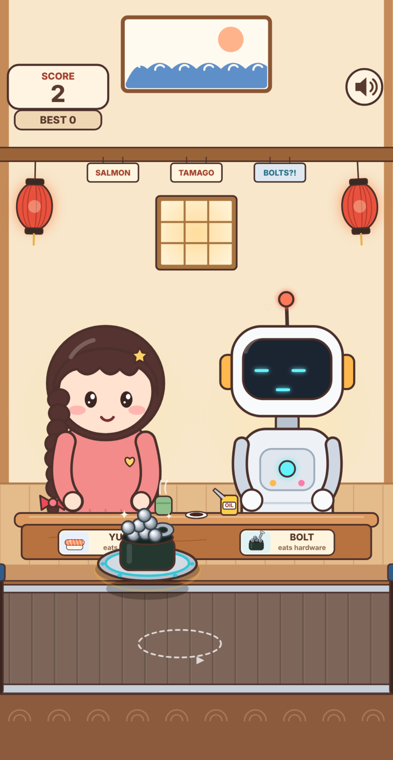
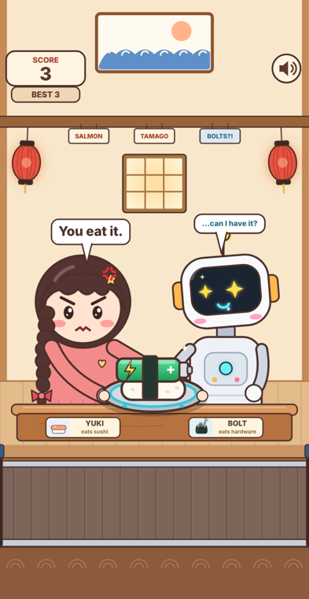

# 🍣 Sushi Date

*I was wondering if a robot could ever just… have dinner with me. So I made a tiny game about it.*

Yuki takes her very serious robot, Bolt, out for conveyor-belt sushi. Your job is to hand out the plates:

- **Sushi → Yuki** (salmon nigiri, tuna gunkan, tamago, shrimp, ikura)
- **Hardware → Bolt** (screw gunkan, lithium tamago, RAM maki, USB tempura, ball-bearing gunkan)

If you get it wrong, the date goes very, very badly.

| | |
|---|---|
|  |  |

## ▶️ Play

**https://aelisonx.github.io/sushi-date/**: works on phones and desktop browsers.

## How to play

- **Drag** a plate onto the right diner, or **tap** it to pick it up and then tap a diner.
- Each correct plate is worth 1 point, and the belt slowly speeds up.
- The game ends **as soon as one plate leaves the belt on the right**. There are no lives, and holding on to a plate doesn't stop it from moving along.
- There are three ways to lose, and each has its own reaction:
  - Feed sushi to Bolt and he crashes: *ORGANIC COMPATIBILITY TEST: FAILED*
  - Feed hardware to Yuki and she holds it out to you: *"You eat it."*, while Bolt stares at it with envy
  - Miss a plate and they both slowly turn to look at you: *"Didn't you say you'd grab it?"*

Press `M` to mute and `Space` to start, skip the intro or retry. Your best score is saved in your browser.

## Tech

It's a single, self-contained `index.html` file using Canvas 2D and the Web Audio API. There are no dependencies and no build step, and every character, food item and sound is generated in code.

To run it locally, open `index.html` in any modern browser. All the UI text lives in the `TEXT` object at the top of the script, so it's easy to translate.

---

一位側邊麻花辮女生帶著機器人去吃迴轉壽司，你負責分餐：壽司給她，螺絲軍艦給它。
